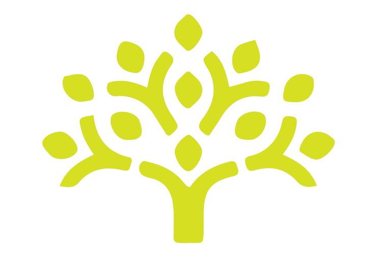

# LEPRASELF — Premium Programming Mastery OS

  
  <h1 style="font-family: 'Quaint-HF', sans-serif; font-size: 3rem; margin-top: 0.5rem;">Lepraself</h1>
  
<em>The Ultimate Learning Operating System for Programmers & Software Engineers.</em>

---

## 📖 The Definition of LEPRASELF

**LEPRASELF** is a self-directed programming mastery suite. The name represents **Self-directed Learning & Personal Mastery (Self)** combined with structured, fast-paced progression. 

Instead of treating roadmap topics like flat bookmark lists, LEPRASELF acts as a **Learning Operating System**. It is designed around the concept of active recall, persistent notes, and time-boxed focus sessions to help engineers transition from passive readers to high-performing builders. It implements an Apple-inspired layout that values whitespace, premium typography, and seamless page transitions.

---

## 📦 What's Inside

LEPRASELF contains a fully parsed learning roadmap containing:

1. **Structured Curriculum Modules**:
   - **Core Subjects**: Computer Science fundamentals and introductory reference materials.
   - **Getting Started**: C++ STL, basic Java, loops, conditions, functions, and patterns.
   - **Data Structures**: Array/Vectors, 2D Arrays (Matrices), Hashing, Strings, Stacks, Queues, Linked Lists, Trees (Binary Trees, BSTs), and Graphs.
   - **Algorithmic Paradigms**: Recursion, Backtracking, Sorting, Searching (Linear/Binary Search), Bit Manipulation, Greedy Algorithms, and Dynamic Programming (DP).

2. **Problem Practice Engine**:
   - **1,500+ Curated Problems**: Deeply integrated external resources from LeetCode, Codeforces, GeeksforGeeks, and premium tutorials.
   - **Completion & Override Tracking**: Persistent indicators tracking what is *Not Started*, *In Progress*, *Solved*, or flagged to *Revisit*.
   - **Language Filters**: Custom toggles to filter roadmaps specifically for C++, Java, Python, or JavaScript.

3. **Productivity Workspace Elements**:
   - **Focus Session Timer**: A real-time timer designed to track study sessions and prevent distractions.
   - **Streak Heatmap**: A GitHub-style heat calendar rendering active study days and consistency metrics.
   - **Integrated Markdown Notes**: Dedicated note panels inside each topic route, auto-saved locally to preserve code snippets and explanations.
   - **Global Command Palette**: Instant navigation across topics using `Ctrl + K`.

---

## 🛠️ How to Use It

### 1. Navigating the Roadmap
- On the **Dashboard**, view all major programming categories. Click on any topic card to enter its dedicated full-page **Workspace**.
- Use the **Search Palette** (`Ctrl + K` or click the search box) to jump to any category instantly.

### 2. Managing Your Study State
- **Checklist**: Click the circular check button next to any reading material or coding problem to mark it complete.
- **Bookmarks**: Click the **Save** button on resources to add them to your persistent **Bookmarks** tab for rapid access.
- **Status Overrides**: Use the buttons (*Not Started*, *In Progress*, *Solved*, *Revisit*) to explicitly set your learning state for each problem.

### 3. Studying & Note-Taking
- In the workspace, read the references on the left and write code notes/snippets in the **Topic Notes** textarea on the right. 
- All note modifications are autosaved instantly to your local storage.

### 4. Running Focus Sessions
- Set your target task in the **Active Study Focus** box on the dashboard.
- Click **Start Study** to begin the timer. Keep the tab open to record your session. When finished, hit **Complete** to log the study hours.
- Monitor your streak heatmap to maintain daily consistency!
